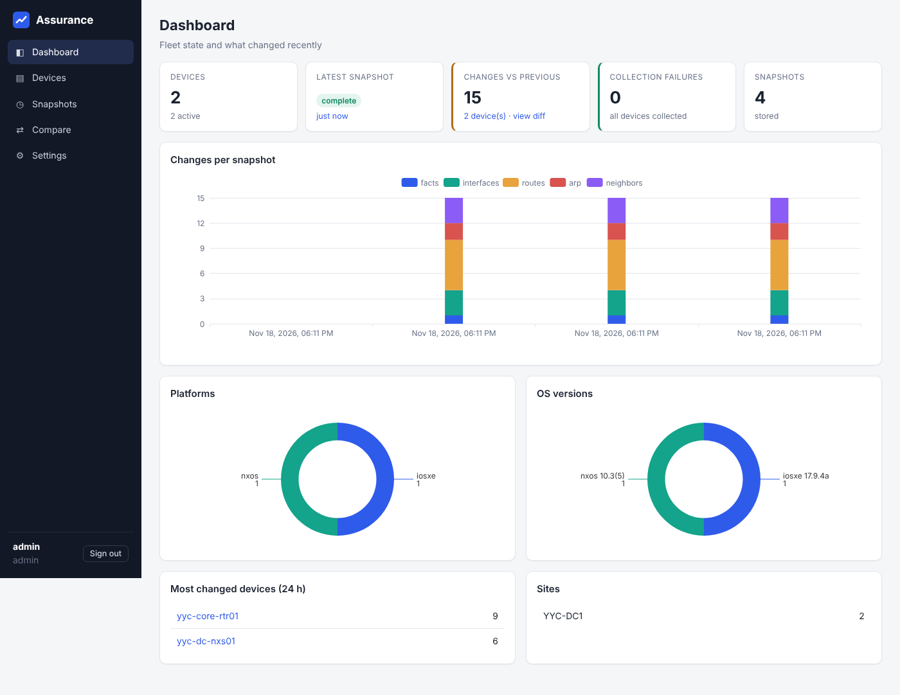
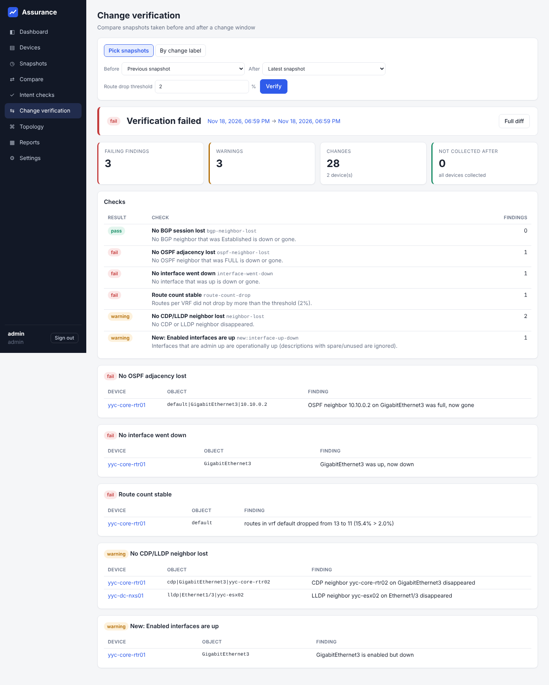
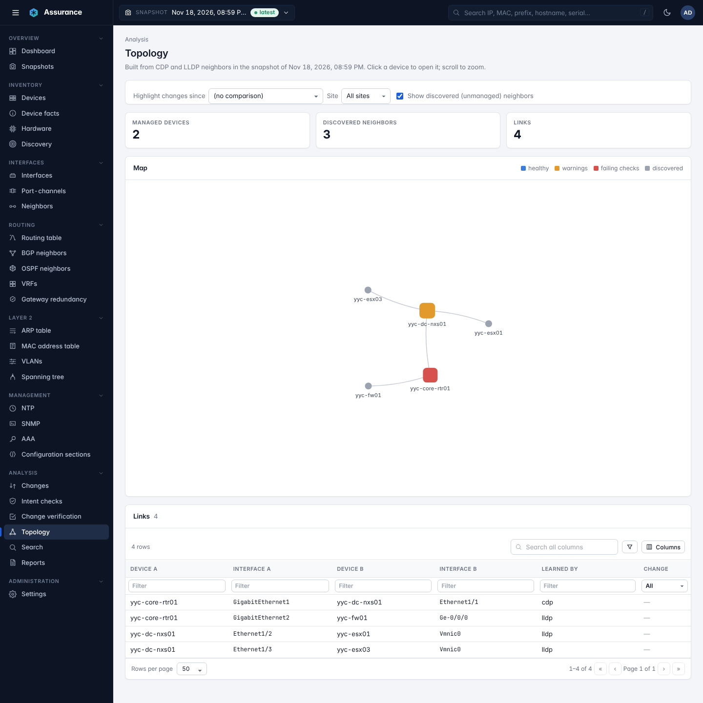
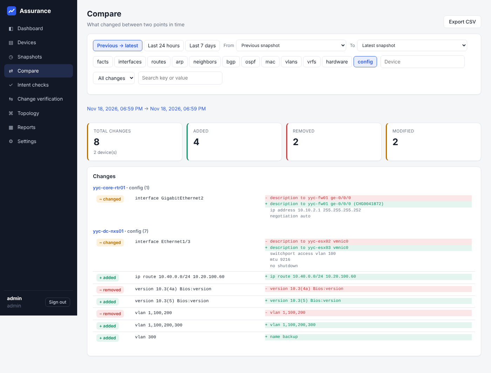
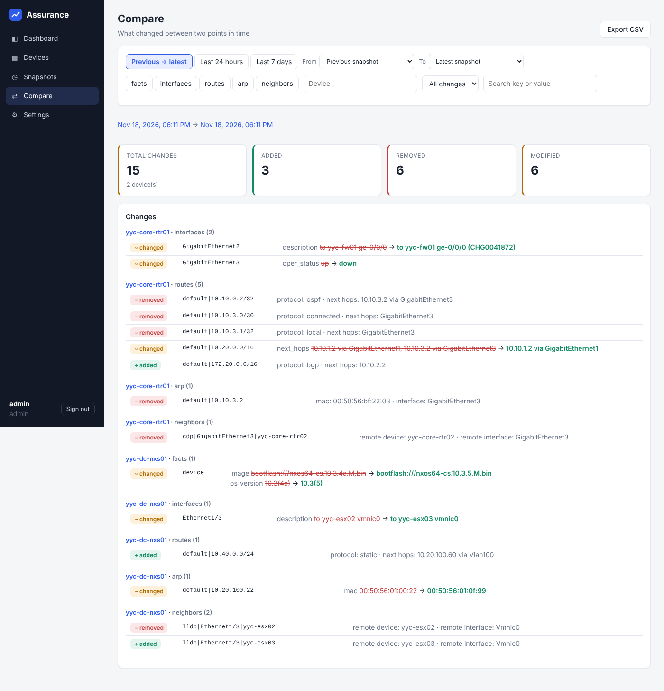

# Assurance

Standalone network assurance for Cisco IOS-XE and NX-OS. Assurance keeps its own device inventory
and credentials, snapshots operational state from every device, parses it with Cisco Genie, keeps
every snapshot, and answers one question well: **what changed between time A and time B, and where.**

Everything is available over a versioned REST API first, with a web UI and a CLI on top. It has no
dependency on any external source of truth or orchestrator.



| Change verification | Topology | Config diff |
|---|---|---|
|  |  |  |

> Release **0.5 (beta)**: everything in 0.1 plus BGP, OSPF, MAC, VLAN, VRF, port-channel, STP, HSRP/VRRP,
> NTP, hardware and running-config tables, SSH host key pinning, intent checks, pre/post change verification, a topology map and reports. Verified against
> captured mock data; not yet run against live devices. See [Roadmap](#roadmap).

## What it does

| Area | Since 0.1 |
|---|---|
| Inventory | Devices, sites, tags, roles, status (active / maintenance / retired); CSV import with dry run; CSV export |
| Credentials | Credential profiles, envelope-encrypted (AES-256-GCM, master key outside the DB); resolved device → site → `default`; write-only over the API |
| Collection | SSH via pyATS/Unicon, parsing with Genie; one job per device on a Redis queue; per-device lock; jitter; partial results kept when a parser fails |
| Data collected | Facts, interfaces, IPv4 routes (all VRFs on NX-OS), ARP, CDP and LLDP neighbors; **0.5:** BGP sessions (all VRFs and address families), OSPF neighbors, MAC table, VLANs, VRFs, port-channels (LACP members, bundled or not), spanning tree (root and port roles per VLAN/MST instance), HSRP and VRRP groups, NTP peers and sync, hardware inventory, running configuration |
| Snapshots | On demand (API, CLI, UI) or on a cron schedule; labels (e.g. `change:CHG0012345`); per-device status; raw CLI text and full Genie output kept in S3 object storage |
| Diff | Keyed diff per table: added / removed / changed with the fields that changed; volatile fields (counters, ages, uptime) ignored; failed devices reported as *unknown*, not as removed; time windows (`24h`, ISO times, `previous`, `latest`) |
| History | Change timeline per device |
| UI | Dashboard (change trend, platforms, OS versions, failures, most-changed devices), devices, snapshots, state tables with search and CSV export, raw output viewer, compare view, settings |
| API | FastAPI under `/api/v1`, OpenAPI at `/api/v1/openapi.json`, docs at `/api/docs`; RFC 9457 problem JSON errors; signed webhooks |
| Access | Local users (Argon2), roles viewer / operator / admin, login lockout, API tokens (hashed, expiring, revocable), audit log |
| Operations | `/healthz`, `/readyz`, Prometheus `/metrics`, JSON logs with request ids, Alembic migrations, retention pruning |

New in 0.5:

| Area | What it does |
|---|---|
| Config | Running config is stored with secrets masked (`secret`, `password`, `key`, SNMP communities, pre-shared keys become `<removed>`) **before** it is written anywhere. Volatile lines (timestamps, "Last configuration change") are dropped. Config is split into sections, so a diff says which section changed, and a unified diff is available per device |
| Intent checks | Every snapshot is graded on completion. 14 built-in state rules (BGP established, OSPF full, enabled interfaces up, MTU and duplex match on both ends of a link, port-channels up with all members bundled, NTP synchronized, HSRP/VRRP healthy with a standby, no HTTP server, NTP configured, SSH v2, AAA, collection succeeded) and 8 delta rules for change verification. Custom rules in YAML or JSON: `row` (filter + assert on any table field), `config_require`, `config_forbid`, with scope by platform, site, role or device. Built-ins can be disabled; rules can be tested before saving |
| Change verification | Pre/post compare by snapshot or by change label. Fails when a BGP session, OSPF adjacency, interface or port-channel member is lost, a spanning-tree root moves, routes per VRF drop beyond a threshold, a device was not collected after, or a state check newly fails. CLI exits 5 on failure for pipelines |
| Topology | Map from CDP and LLDP, managed and discovered nodes coloured by check results, links added or removed since any earlier snapshot |
| SSH host keys | Each device's SSH host key is pinned on first contact (or must be pinned in advance in strict mode). A changed key fails the collection before any credentials are sent, and is audited. The session that logs in is bound to the pinned key through a one-off known_hosts file |
| Reports | Change, compliance and inventory reports as printable HTML (save as PDF), Excel and CSV, from the UI, API or CLI |

## Quick start (Docker Compose, single server)

```bash
cp .env.example .env           # set every password
./deploy/init-secrets.sh       # creates secrets/master.key and secrets/s3.json
docker compose up -d --build
```

Open <http://localhost:8000> and sign in as `admin` with `ASSURANCE_BOOTSTRAP_ADMIN_PASSWORD`. Then:

1. **Settings → Device credentials**: add a profile named `default` (a read-only account limited to show commands).
2. **Devices → Import CSV**: `name,host,platform,site,role,tags` (platform `iosxe` or `nxos`).
3. **Snapshots → New snapshot**, or add an hourly schedule under Settings.

The stack is PostgreSQL 16, Redis 7, an S3-compatible object store (SeaweedFS bundled; MinIO,
Ceph RGW or AWS S3 work by setting `ASSURANCE_S3_ENDPOINT_URL`), the API/UI, two collection workers
and the scheduler. App containers run as a non-root user on read-only file systems.

**Try it without devices:** set `ASSURANCE_COLLECTOR=mock` in `.env`, then take two snapshots from
the captured lab output in `mock_data/`:

```bash
assurance snapshot --mock-scenario t1
assurance snapshot --mock-scenario t2
assurance diff
```

`t2` differs from `t1` by: rtr01 Gi3 link down (routes, ARP and CDP neighbor lost, ECMP collapses),
a new BGP prefix and a description change; nxs01 an OS upgrade, a new static route, an ARP MAC move
and an ESXi host swap on Eth1/3.



## CLI

The `assurance` command is a client of the API, so it runs anywhere that can reach the server.

```bash
pip install .                                    # or use the container image
assurance login --url https://assurance.example.com
assurance devices import devices.csv             # dry run; add --apply to write
assurance snapshot --site YYC-DC1 --label change:CHG0012345     # waits, prints the id
assurance snapshots list
assurance diff                                   # previous -> latest
assurance diff 24h now --table routes            # what changed in the last 24 hours
assurance diff <pre-id> <post-id> --fail-on-change   # exit 3 if anything changed
assurance snapshots table routes --device yyc-core-rtr01 -q bgp
assurance devices history yyc-core-rtr01 --since 7d
assurance prepost --label change:CHG0012345     # exit 5 if verification fails
assurance checks rules
assurance checks show latest --severity fail --fail-on-violation
assurance config diff yyc-core-rtr01 previous latest
assurance report compliance --format xlsx -o compliance.xlsx
```

`ASSURANCE_URL` and `ASSURANCE_TOKEN` override the stored login, which is handy in pipelines.

Server administration uses `assurance-admin`: `migrate`, `create-user`, `reset-password`,
`gen-master-key`, `worker`, `scheduler`, `prune`.

### Pre/post change check

```bash
PRE=$(assurance snapshot --site YYC-DC1 --label change:CHG0012345)
# ... make the change ...
POST=$(assurance snapshot --site YYC-DC1 --label change:CHG0012345)
assurance prepost --label change:CHG0012345      # PASS / WARN / FAIL with findings; exit 5 on FAIL
assurance diff "$PRE" "$POST"                    # every change, for the record
```

Snapshots with labels are kept by `assurance-admin prune`, so the evidence stays available.

## API

Authenticate with `Authorization: Bearer <token>`: create a token under Settings → API tokens, or
`POST /api/v1/auth/login`. The full reference is served at `/api/docs`.

| Method and path | Purpose |
|---|---|
| `GET/POST /devices`, `GET/PATCH/DELETE /devices/{name}` | Inventory |
| `POST /devices/import?dry_run=true`, `GET /devices/export.csv` | CSV import and export |
| `GET/POST /sites`, `PATCH/DELETE /sites/{name}` | Sites (optional default credential per site) |
| `GET/POST /credentials`, `PATCH/DELETE /credentials/{name}` | Credential profiles; secrets are write-only |
| `POST /snapshots` | Start a snapshot: `{scope: {site, role, platform, tags, devices}, labels, callback_url}`. Returns **202** and a `Location` |
| `GET /snapshots`, `GET /snapshots/{ref}` | List and status. `ref` is an id, `latest`, `previous`, an ISO time or an age like `24h` |
| `GET /snapshots/{ref}/tables/{table}` | Normalized state. Filter by any field (`?protocol=bgp&vrf=default`), `?q=` search, `?format=csv` |
| `GET /snapshots/{ref}/raw/{device}[/{command}]` | Raw CLI text, or `?kind=genie` for the full parser output |
| `GET /diffs?from=&to=` | Diff; `table`, `device`, `change`, `format=json\|text\|csv`. `since`/`until` are aliases for time windows |
| `GET /devices/{name}/history` | Change timeline for one device |
| `GET /stats/overview` | Dashboard numbers |
| `GET/POST /checks/rules`, `PATCH/DELETE /checks/rules/{id}`, `POST /checks/rules/test` | Intent rules (admin to change) |
| `GET /snapshots/{ref}/checks`, `POST /checks/run`, `GET /checks/trend` | Violations, re-grade, trend |
| `POST /compare/prepost` | Change verification: `{pre, post}` or `{label}`, plus `route_drop_pct` |
| `GET /topology?compare=&site=` | Nodes and links, with link changes |
| `GET /diffs/config?device=&from=&to=`, `GET /devices/{name}/config` | Config diff and masked config |
| `GET /reports/{changes,compliance,inventory}?format=html\|csv\|xlsx` | Reports |
| `PATCH /devices/{name}` with `ssh_host_key`, `DELETE /devices/{name}/host-key` | Pin an SSH host key by hand, or forget the pin (admin) |
| `GET/POST /schedules`, `PATCH/DELETE /schedules/{name}` | Cron schedules (UTC) |
| `POST /auth/login`, `/auth/logout`, `GET /auth/me`, `GET/POST/DELETE /auth/tokens` | Sessions and API tokens |
| `GET/POST /users`, `PATCH /users/{name}` | Users (admin) |
| `GET /audit` | Audit log (admin) |

Tables: `facts`, `interfaces`, `routes`, `arp`, `neighbors`, `bgp`, `ospf`, `mac`, `vlans`, `vrfs`,
`hardware`, `portchannels`, `stp`, `fhrp`, `ntp`, `config`. A diff change looks like
`{device, table, key, change: added|removed|changed, before, after, fields_changed}`.

Webhooks: when `callback_url` is given, a `snapshot.finished` event is POSTed when the snapshot
completes, signed with `X-Assurance-Signature: sha256=<HMAC-SHA256 of the body>` using
`ASSURANCE_WEBHOOK_SECRET`, and retried with backoff.

## Configuration

All settings are environment variables (or `.env`), prefixed `ASSURANCE_`.

| Variable | Default | Notes |
|---|---|---|
| `DATABASE_URL` | `postgresql+psycopg://…/assurance` | PostgreSQL 16 |
| `REDIS_URL` | `redis://localhost:6379/0` | Job queue, device locks, scheduler leader lock |
| `OBJECT_STORE` | `s3` | `s3` or `filesystem` (lab only) |
| `S3_ENDPOINT_URL`, `S3_BUCKET`, `S3_ACCESS_KEY`, `S3_SECRET_KEY` | | Bucket is created if missing |
| `MASTER_KEY_FILE` / `MASTER_KEY` | | 32-byte base64 key for the credential store. Prefer the file. **Back it up separately**; losing it means re-entering device credentials |
| `JOB_BACKEND` | `rq` | `rq` (workers), `thread` (single process, lab), `sync` (tests) |
| `COLLECTOR` | `live` | `live` (SSH) or `mock` (reads `MOCK_ROOT`) |
| `COLLECT_TIMEOUT` | `60` | Seconds per command |
| `COLLECT_JITTER_SECONDS` | `2` | Random delay before each device connects |
| `SSH_HOST_KEY_POLICY` | `tofu` | `tofu` pins on first contact, `strict` requires a pin, `off` disables checking |
| `SESSION_HOURS`, `MAX_FAILED_LOGINS`, `LOCKOUT_MINUTES` | `12`, `5`, `15` | |
| `BOOTSTRAP_ADMIN_PASSWORD` | | Creates user `admin` on the first `migrate` when no user exists |
| `WEBHOOK_SECRET` | | HMAC key for webhook signatures |
| `LOG_LEVEL`, `LOG_JSON` | `INFO`, `true` | |

## Development

```bash
python3 -m venv .venv && . .venv/bin/activate
pip install -e '.[dev]'
export TEST_DATABASE_URL=postgresql+psycopg://postgres@localhost:5432/assurance_test
pytest                       # needs a PostgreSQL database; uses mock_data and the filesystem store
ruff check assurance tests

cd frontend && npm ci && npm run dev    # UI on :5173, proxies /api to :8000
npm run build                           # writes assurance/ui, served by the API
```

Run the API locally with `uvicorn --factory assurance.api.app:create_app --reload` and
`ASSURANCE_JOB_BACKEND=thread` so no worker is needed.

## Code map

| Path | Role |
|---|---|
| `assurance/collection/` | Commands per OS, pyATS/Unicon and mock collectors, offline Genie parsing, normalizers |
| `assurance/services/snapshots.py` | Snapshot lifecycle: create, per-device job, finalize, webhooks |
| `assurance/services/diff.py` | Snapshot reference resolution and the keyed diff engine |
| `assurance/services/checks.py` | Intent rules (built-in and custom), grading, pre/post verification |
| `assurance/collection/configtext.py` | Secret masking, config cleaning and sectioning |
| `assurance/api/routes/analysis.py` | Topology, config diffs, reports |
| `assurance/services/inventory.py` | Scope resolution, validation, CSV import/export |
| `assurance/services/credentials.py`, `security/crypto.py` | Credential profiles and envelope encryption |
| `assurance/services/schedules.py` | Cron schedules and the scheduler loop |
| `assurance/api/` | FastAPI app, routes, schemas, auth dependencies, problem JSON |
| `assurance/cli/` | `assurance` (API client) and `assurance-admin` |
| `assurance/models.py`, `migrations/` | Database schema and Alembic migrations |
| `frontend/` | React + TypeScript + ECharts UI |
| `mock_data/` | Captured IOS-XE and NX-OS output for tests and demos |

## Security notes

- Device secrets are encrypted per profile with a random data key, which is itself encrypted by the
  master key. Ciphertext is bound to its profile and field, and secrets never appear in API
  responses, logs or the audit log.
- API tokens and session tokens are 256-bit random values stored as SHA-256 hashes. Passwords use Argon2.
- Every change to inventory, credentials, schedules, users and tokens, and every snapshot request, is audited.
- The UI is served with a strict Content Security Policy, `X-Frame-Options: DENY` and `nosniff`.
- SSH host keys are pinned per device (`ASSURANCE_SSH_HOST_KEY_POLICY`: `tofu` default, `strict`, `off`).
  A changed key stops collection for that device until an admin resets the pin.
- Secrets are masked in every collected output (not only the running config) before parsing or storage.
- Use a dedicated read-only device account (TACACS+ command authorization or a low privilege level).
- Put TLS in front of the API (reverse proxy or load balancer) in any shared environment.

## Roadmap

From the architecture doc's release plan:

- **0.5 beta (this release):** BGP, OSPF, MAC, VLANs, VRFs, port-channels, STP, HSRP/VRRP, NTP,
  hardware, configs, intent checks, topology, pre/post verification, reports, SSH host key pinning.
  Still to do: check profiles per change type (which rules a given change must pass).
- **1.0 GA:** HA deployment (Helm), OIDC SSO, backup/restore, OpenTelemetry tracing, hardening and pen test.

Known gaps: the live collector has not been run against real devices yet (mock data only); IOS-XE
collects the global routing table only (no per-VRF commands yet); no IPv6; no reachability check
when a device is added; no rate limiting on the API; no VRRP on NX-OS (Genie has no parser for it); the topology map is one level (no site grouping).
